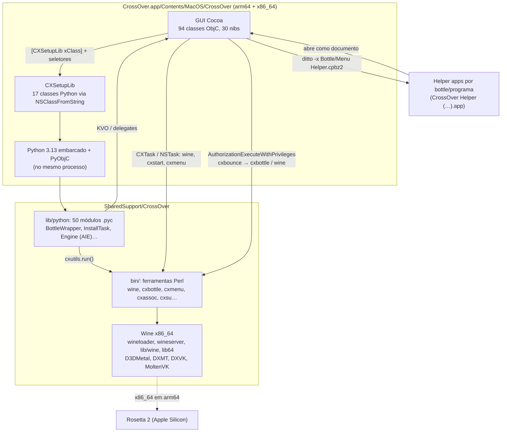

# Arquitetura do CrossOver 26.3 para Mac (GUI ↔ backend)

Este documento junta o que foi recuperado em [`decompiled/`](decompiled), na GUI em Objective-C, e em [`sharedsupport/`](sharedsupport), nas ferramentas Perl, na biblioteca Python e no Wine. Tudo vem de análise estática. Quando uma afirmação é inferência e não leitura direta do código, isso está dito.

## Camadas

| Camada | Onde | Linguagem | Papel |
|---|---|---|---|
| GUI | `Contents/MacOS/CrossOver` | Objective-C (universal) | Janelas, menus, Dock e eventos do macOS. Decide *o que* fazer e delega quase tudo |
| Ponte | `CXSetupLib` + `Contents/Resources/libcxsetup*.py` + `lib/python/cxobjc` | ObjC + Python | Sobe o interpretador e expõe classes Python como classes Objective-C |
| Modelo e lógica | `SharedSupport/CrossOver/lib/python` | Python 3.13 (`.pyc`) | Estado das bottles, perfis C4, motor de instalação (AIE), registro, avaliações |
| Ferramentas | `SharedSupport/CrossOver/bin` | Perl e shell | CLI que monta o ambiente do Wine e altera bottles, menus e associações |
| Execução Windows | `bin/wineloader`, `bin/wineserver`, `lib/wine`, `lib64` | C (x86_64) | O Wine em si e os tradutores gráficos |

## 1. Inicialização

1. O `NSApplication` principal é um `CXApplication`. O `MainMenu.nib` instancia `CXServerCrossOver` (subclasse de `CXServer`), `MainWindowController` e `CXUpdater` (Sparkle).
2. `-[CXServer applicationWillFinishLaunching:]` chama `rosettaCheck`, só na slice arm64. Se o Rosetta 2 não estiver instalado, abre `RosettaInstallationController`, cujo botão roda `/usr/sbin/softwareupdate --install-rosetta --agree-to-license` via `NSTask` ([detalhes](decompiled/x86_64)).
3. Na primeira mensagem a `CXSetupLib`, `+[CXSetupLib initialize]` chama `_InitializePython(@"libcxsetup.py")`. O endereço `0x1000a5718` foi resolvido na `__cfstring` da arm64.
4. `_InitializePython` ([`c_functions.c`](decompiled/c_functions.c), `0x1000541d4`):
   - pega `crossOverRoot` (`…/SharedSupport/CrossOver`) e define `PYTHONPATH=<root>/lib/python`;
   - remove `PYTHONEXECUTABLE`, `PYTHONHOME`, `PYTHONINSPECT`, `PYTHONSTARTUP` e `PYTHONUSERBASE`, e define `LC_CTYPE=en_US.UTF-8` só durante a inicialização, se a variável estiver ausente;
   - liga `Py_NoUserSiteDirectory` e chama `Py_InitializeEx(0)` (sem instalar handlers de sinal do Python);
   - importa `cxutils` e grava `cxutils.CX_ROOT`;
   - roda `Contents/Resources/libcxsetupbase.py` e depois `libcxsetup.py` com `PyRun_SimpleFileExFlags`. Se algo falhar, levanta `NSInternalInconsistencyException`;
   - solta o GIL (`PyEval_SaveThread`). Daí em diante, cada chamada do Objective-C ao Python passa pelo PyObjC, que pega o GIL de novo.
5. De volta em `+initialize`, `NSClassFromString` resolve 17 classes Python, guardadas em variáveis globais. Se alguma faltar, o app registra `"Unable to load the … class."` e termina.

| Getter em `CXSetupLib` | Classe Python | Módulo | Usada por (GUI) |
|---|---|---|---|
| `bottleCollectionClass` | `BottleCollection` | `bottlecollection` | 19 classes, quase sempre via `sharedCollection` |
| `cxSetupClass` | `CXSetup` | `Resources/libcxsetup.py` | `CXServer`, `CXServerCrossOver`, `BottleMenuHandler`, `InstallConfiguration`, `PackageInstaller`, `SelectBottleSheetController` |
| `demoUtilsClass` | `DemoUtils` | `demoutils` | `CXApplication`, `RegistrationController` |
| `bottleManagementClass` | `BottleManagement` | `bottlemanagement` | `NewBottleController`, `NoBottleController`, `BottleMenuHandler`, `SelectBottleSheetController` |
| `c4ProfilesClass` | `C4Profiles` | `c4profilesmanager` | `PackageViewController`, `BottleViewController`, `MainWindowController`, `CXServerCrossOver`, `CDTools`, `SubmitRatingController` |
| `cxUtilsClass` | `CXUtils` | `cxutils` | `RunCommandController`, `InstallConfiguration`, `InstallOptionsSheetController`, `LoggingOption`, `PackageTreeNode` |
| `bottleQueryClass` | `BottleQuery` | `bottlequery` | `NewBottleController`, `NoBottleController`, `PublishController` |
| `installTaskClass` | `InstallTask` | `installtask` | `InstallConfiguration`, `BottleViewController` |
| `cxAiEngineClass` | `Engine` | `cxaiengine` | `InstallConfiguration` |
| `cxMenuClass` | `CXMenu` | `cxmenu` | `RunCommandController` |
| `bottleWrapperClass` | `BottleWrapper` | `bottlewrapper` | `MainWindowController` |
| `webUtilsClass` | `WebUtils` | `webutils` | `MainWindowController`, `RegistrationController`, `SubmitRatingController` |
| `ratingUtilsClass` | `RatingUtils` | `ratingutils` | `SubmitRatingController` |
| `systemInfoClass` | `SystemInfo` | `systeminfo` | `RunCommandController` |
| `iconUtilsClass` | `IconUtils` | `iconutils` | `PackageTreeNode` |
| `cdDetectorClass` | `CDDetector` | `cddetector` | `CDTools` |
| `appDetectorClass` | `AppDetector` | `appdetector` | (só resolvida em `+initialize`) |

`-[CXServerCrossOver runCXUpgrade]` executa `lib/cxupgrade --productid … --old-version …`, com a versão anterior tirada da preferência `FirstRunVersion`. Pelo nome e pelos argumentos, serve para migrar a configuração quando o CrossOver é atualizado (inferência).

## 2. A ponte Objective-C ↔ Python

O mapa completo, seletor por seletor, está em [`sharedsupport/python/BRIDGE.md`](sharedsupport/python/BRIDGE.md): 19 classes, 49 propriedades e 148 seletores, dos quais 132 aparecem em `__objc_methname` da GUI.

**Do Objective-C para o Python.** As classes Python herdam de `cxobjc.Proxy`, uma subclasse de `NSObject`. Para o runtime ObjC, elas são classes comuns. A GUI usa três formas de nomear:

| Forma no Python | Exemplo | Como a GUI chama |
|---|---|---|
| `@cxobjc.method(Classe, 'sel_')` em função de módulo | `create_bottle` → `+[BottleManagement createBottle:fromTemplate:]` | Método de classe: `[[CXSetupLib bottleManagementClass] createBottle:… fromTemplate:…]` |
| `@cxobjc.namedSelector(b'sel')` em método | `BottleWrapper.set_graphics_backend_d3dmetal` → `-setGraphicsBackendD3DMetal` | Método de instância em um objeto Python (`[bottle setGraphicsBackendD3DMetal]`) |
| Método com nome no padrão PyObjC | `InstallTask.setInstallerSource_Requested_` → `-setInstallerSource:Requested:` | Igual, pelo nome traduzido (`_` → `:`) |
| `cxobjc.object_property(python_name=…, typestr=…, depends_on=…)` | `BottleWrapper.isD3DMetalAvailable` ← `is_d3dmetal_available` | KVC/KVO e Cocoa Bindings. `depends_on` vira `keyPathsForValuesAffecting…`, então a interface atualiza quando o estado Python muda |

`@cxobjc.python_method` (103 usos) esconde um método do Objective-C.

**Do Python para o Objective-C.** O retorno vem por dois caminhos:

- **KVO** nas propriedades acima. `BottleWrapper` tem 47 propriedades, como `isBusy`, `isUpToDate`, `canForceQuit`, `isD3DMetalEnabled`, `isMSyncEnabled` e `isHighResolutionEnabled`.
- **Delegates** marcados com `@cxobjc.delegate` no Python e implementados no Objective-C:
  - `BottleCollection` avisa `-[CXServerCrossOver bottleCollectionChanged]` (registrado com `addChangeDelegate:`);
  - `InstallTask` chama `profileChanged`, `sourceChanged`, `categorizedBottle:`, `categorizedAllBottles`, `analyzedBottle:`, `bottleCreateChanged`, `bottleNameChanged`, `profileMediaAdded:`… em `InstallConfiguration`, `PackageInstaller`, `InstallOptionsSheetController` e `SelectBottleSheetController`.

**Threads.** As operações demoradas de bottle rodam em uma fila Python própria (`pyop.PythonOperationQueue`, com subclasses como `QuitBottleOperation`, `ForceQuitBottleOperation`, `DeleteBottleOperation` e `RenameBottleOperation`). Os passos de instalação rodam em uma `NSOperationQueue` da GUI (`InstallationOperation`). Os dois lados devolvem o resultado na thread principal.

## 3. Como a GUI chega ao Wine

Há dois caminhos: indireto, pelo Python, e direto, quando a GUI executa um processo.

### 3.1 Pelo Python (`cxutils.run`)

| Ação na GUI | Objective-C | Python | Processo |
|---|---|---|---|
| Criar bottle (`NewBottle.nib` → `createPressed:`) | `NewBottleController` em thread separada | `BottleManagement.createBottle:fromTemplate:` → `create_bottle` | `cxbottle --bottle N --create --template T --install` |
| Duplicar, arquivar, restaurar | `MainWindowController`, `NewBottleController` | `copy_bottle`, `archive_bottle`, `restore_bottle` | `cxbottle --copy`, `--tar`, `--restore` |
| Apagar bottle | `BottleMenuHandler` → `-[BottleWrapper delete:]` | `delete_bottle` | `cxbottle --bottle N --removeall --delete --force`. As strings da função também incluem `cxsu --ignore-home` e `--scope private`, usadas para a bottle gerenciada e o seu "stub" privado (`Failed to delete the stub for %s.`) |
| Encerrar (`quitBottle:`) | `MainWindowController` → `BottleMenuHandler` → `-[BottleWrapper quit:]` | `QuitBottleOperation` → `quit_bottle` | `wine --bottle N --no-update --wl-app wineboot.exe -- --end-session --shutdown --force --kill` |
| Forçar encerramento | `-[BottleWrapper forceQuit:]` | `kill_bottle` | `wine --bottle N --no-update --ux-app wineserver -k` |
| Trocar backend gráfico (menu ou `BottleView.nib`) | `toggleBottleGraphicsD3DMetal:` / `graphicsOptionChanged:` | `set_graphics_backend_{auto,d3dmetal,dxmt,dxvk,wine}`, `set_vulkan_backend_{moltenvk,mtlvk}`, `enable_dlss`… | Grava a configuração da bottle (`set_config_value`). O `bin/wine` lê `cxbottle.conf` da bottle ao iniciar; a chave exata não foi confirmada |
| Instalar software (`PackageView.nib` → `install:`) | `PackageViewController` → `PackageInstaller` + `InstallConfiguration` | `InstallTask` (configuração) → `Engine` (AIE) → tarefas `cxaiecore` | `cxavscan`, `wine --bottle N --wait-children --new-console … --wl-app <instalador>`, `wine … wineboot.exe --restart`, `cxmenu --sync`, `cxassoc --sync` |
| Painel de controle e aplicativos instalados | `BottleViewController` | `load_control_panel_info`, `load_application_info` | `wine --bottle N --no-gui --wl-app cxcplinfo.exe …` |
| Registro / licença | `RegistrationController` | `DemoUtils` | Validação da licença, que pode chamar `cxsu`/`cxregister` |

A instalação é a parte mais elaborada:

1. `InstallConfiguration` cria o `InstallTask` (`initWithDelegate:`) e o preenche com perfil C4, mídia, bottle e dependências.
2. Depois cria o `Engine` (`initWithInstallTask:logFile:channels:env:`), um `AIEScheduler`.
3. `PackageInstaller` pede `sortedRunnable` ao `Engine`, chama `schedule:` em cada tarefa e a embrulha em `InstallationOperation`.
4. A operação chama o `main` Python da tarefa. O retorno BOOL volta em `taskCompleted:` na thread principal.
5. O ciclo se repete até `allDone`.

### 3.2 Processos lançados diretamente pela GUI

| Método | Executável | Argumentos (formato) |
|---|---|---|
| `-[CXServer runClient:inBottle:]` | `bin/cxstart` (symlink para `wine`) | `--bottle N --wait-children --enable-alt-loader macdrv --untrusted <arquivo>` |
| `-[CXServer handleGetURLEvent:withReplyEvent:]` | `bin/cxstart` | Mesmo formato, com `-- <url>`. Trata o esquema `com.codeweavers.private-CrossOver-app-scheme` |
| `-[CXServerCrossOver runClient:inBottle:withDialog:]` | `bin/wine` | `--bottle N --start <arquivo>`. Antes, desvia instaladores (`setup.exe`, `autorun.inf`, `.msi`), `.cxarchive`, `.c4p` e `.tie` (CrossTie) para os fluxos da GUI |
| `-[CXServer forkExecCommand:withArgs:]` | `/bin/sh -c …` via `CXTask` | Exporta `CX_LAUNCH_NOTIFY_SOCKET` (aparentemente para o processo avisar que abriu e o Dock mostrar o progresso; inferência) |
| `-[RunCommandController runCommand]` | `bin/cxstart` ou `bin/cxmenu` | `--bottle N --verbose --cx-log …`, `--debugmsg`, `--env`, `--workdir`, `-- <comando>`. Somam-se `ROSETTA_ADVERTISE_AVX=0` (`AVXSelected:`) e `MTL_HUD_ENABLED=1` (`metalHudSelected:`) |
| `-[CXServerCrossOver repairBottles:]` | `bin/wine` | `--bottle N …` para cada bottle |
| `-[UpdateController updateBottle:WithAuthorization:]` | `bin/wine` (bottle privada) ou `bin/cxbounce wine …` (gerenciada) | Atualiza a bottle para a versão atual do CrossOver |
| `-[CXServerCrossOver runCXUpgrade]` | `lib/cxupgrade` | `--productid …`, `--old-version …` |
| `setupHelperAppForBottleWithTag:…`, `exportProgram:…` | `/usr/bin/ditto -x` | Extrai `Bottle Helper.cpbz2` ou `Menu Helper.cpbz2` de `Contents/Resources` |
| `-[RosettaInstallationController installButton:]` | `/usr/sbin/softwareupdate` | `--install-rosetta --agree-to-license` |

### 3.3 Bottles gerenciadas e privilégios

Bottles gerenciadas ficam fora do diretório do usuário e exigem root. A GUI pede uma `AuthorizationRef` e usa `AuthorizationExecuteWithPrivileges` em quatro lugares:

| Quem | Executa |
|---|---|
| `+[BottleMenuHandler deleteManagedBottle:withWindow:authorization:]` | `bin/cxbounce cxbottle …` |
| `-[PublishController doPublish]` (publicar uma bottle para todos os usuários) | `bin/cxbounce cxbottle …` |
| `-[UpdateController updateBottle:WithAuthorization:]` | `bin/cxbounce wine --bottle …` |
| `RegistrationController` | `/bin/mv` (instala o arquivo de licença) |

`cxbounce` é um Mach-O x86_64 mínimo. Importa só `setuid`, `execv`, `dirname`, `sprintf`, `strlen`, `malloc`, `printf` e `puts`, e tem a string `%s/%s` (REA `ev_d868c232…`). O padrão indica que ele faz `setuid(0)` e depois `execv("<dirname(argv[0])>/<argv[1]>", …)`. Assim o script Perl irmão roda com UID real 0, e não só efetivo como no `AuthorizationExecuteWithPrivileges`. A ordem exata é inferência pelos imports; o binário não foi descompilado.

## 4. Integração com o macOS: helper apps

`CXServerCrossOver` gera aplicativos pequenos que o Finder, o Launchpad e o Dock tratam como apps nativos:

- **Por bottle** (`setupHelperAppForBottleWithTag:andName:andExtensions:usingExistingHelper:`): extrai `Bottle Helper.cpbz2` em `Helpers/CrossOver Helper (<bottle>).app`. Grava no `Info.plist` `CXHelperAppBottleName`, `CXHelperAppBottleTag`, `CXHelperAppVersion`, `CFBundleDocumentTypes` (as extensões que a bottle abre) e `CFBundleURLTypes` (por exemplo `mailto`), com identificador `com.codeweavers.CrossOverHelper.<tag>`.
- **Por programa** (`exportProgram:bundleName:withDictionary:toFolder:`): extrai `Menu Helper.cpbz2` e grava `CrossOverHelperCommand`, `CXHelperAppBottleName`, o ícone convertido do `.exe` e um identificador `com.codeweavers.CrossOverHelper.<tag>.<nome>`, expandindo `%WINEPREFIX%` e `%CX_ROOT%` no comando.

Quando um helper é aberto, o CrossOver recebe o bundle como documento. `runClient:inBottle:withDialog:` lê `CrossOverHelperCommand` e `CrossOverHelperMenuPath` e executa `bin/wine`. A mensagem `"CrossOver got non-CrossOver bundle as document"` cobre o caso contrário. Os menus vêm do lado Perl: `cxmenu` com o backend `CXMenuMacOSX`, e `wineshelllink` quando um programa Windows cria um atalho.

## 5. Arquitetura de CPU

| Componente | Arquiteturas |
|---|---|
| GUI `Contents/MacOS/CrossOver` | arm64 + x86_64 (universal) |
| `Python.framework` (3.13) | o mesmo processo da GUI |
| `bin/wineloader`, `wineserver`, `cxbounce`, `cxgettext`, `cabextract`, `unrar`, `ps2pdf_gs` | só x86_64 |
| `lib64/*.dylib` (95), `lib/wine/x86_64-unix` | só x86_64 |
| `lib/wine/{i386,x86_64}-windows`, `lib/dxvk`, `lib/dxmt` | PE (Windows) |

Em Apple Silicon, a GUI e o Python rodam nativos e todo o Wine roda sob Rosetta 2. `bin/wine` e `cxproduct` testam `lib/wine/aarch64-unix/ntdll.so`, que não existe nesta versão. O mesmo recurso aparece nas três camadas no caso do AVX: `RunCommandController.supportsAVX`/`AVXSelected:` na GUI, `ROSETTA_ADVERTISE_AVX` no `bin/wine` e o Rosetta (ver [`sharedsupport/README.md`](sharedsupport/README.md#rosetta-e-avx-o-mesmo-recurso-nas-três-camadas)).

## Evidence e método

- **Pseudocódigo da GUI**: Hopper via REA, slice arm64 ([`decompiled/classes`](decompiled/classes), [`decompiled/c_functions.c`](decompiled/c_functions.c)). As strings citadas (`@"…"`) e os endereços vêm daí.
- **Strings por endereço**: `__cfstring` / `__objc_methname` lidos do Mach-O por [`decompiled/x86_64/.slicediff.py`](decompiled/x86_64/.slicediff.py) e [`sharedsupport/.tools/bridge.py`](sharedsupport/.tools/bridge.py). Desmontagem arm64 do REA `ev_be740f96d13b18f1147404d9cca0dc483fac76d20283b87339857ccc3eb23143`.
- **Nibs**: REA `decode_interface_builder` (`ev_1a33de7e68748d811e6f96b4101fee0c4cb205a3febe4864214fe4bcda86c5e2`): 41 documentos (os 30 nibs do CrossOver, alguns em duas versões de formato, mais os do Sparkle), 5534 nós, 648 ligações target-action. Os controladores e as ações das seções 3 e 4 vêm daí.
- **Binários do backend**: REA `inspect_macho` em `wineloader` (`ev_fcbd34d1…`), `wineserver` (`ev_503ade64…`) e `cxbounce` (`ev_d868c232…`).
- **Python e Perl**: [`sharedsupport/`](sharedsupport), com a leitura do bytecode 3.13 e o inventário dos scripts.

## Limites

- Nada foi executado. A ordem de eventos em tempo de execução é deduzida do código.
- REA não decodifica as conexões de binding (`NSNibBindingConnector`) dos nibs. As ligações por Cocoa Bindings entre a interface e as propriedades Python não estão listadas; só as target-action e outlets. Em 16 documentos, de 1 a 6 conexões ficaram sem resolver.
- A coluna "Usado em" de `BRIDGE.md` é uma busca textual no pseudocódigo e pode incluir homônimos (`init`, `resume`, `suspend`).
- O corpo das funções Python não foi descompilado. Os comandos citados vêm das strings e dos nomes que cada função usa (esboço em [`sharedsupport/python/outline`](sharedsupport/python/outline)).
- `cxbounce` e `CX_LAUNCH_NOTIFY_SOCKET` estão descritos por inferência.
